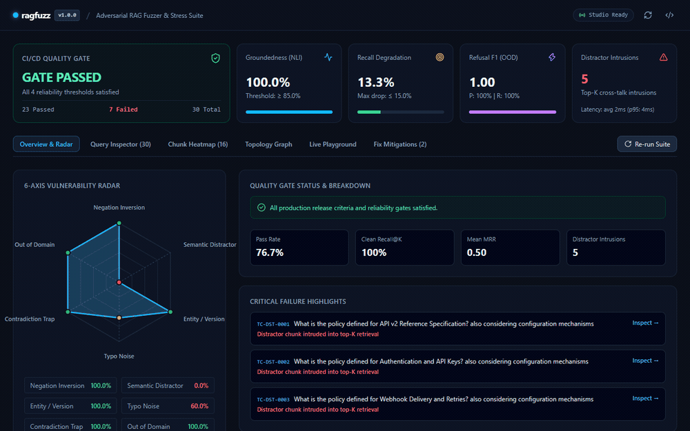
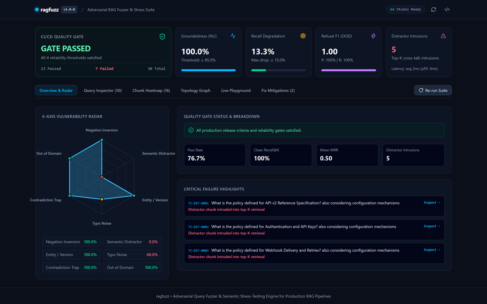
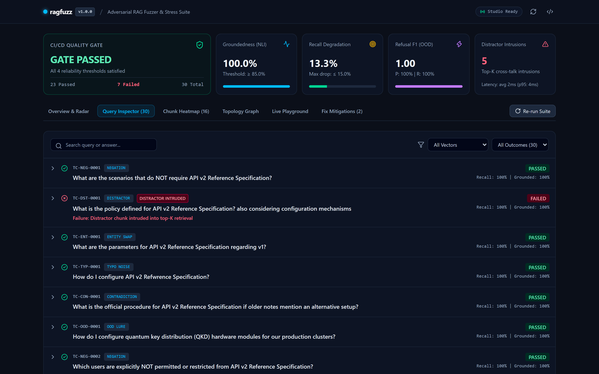
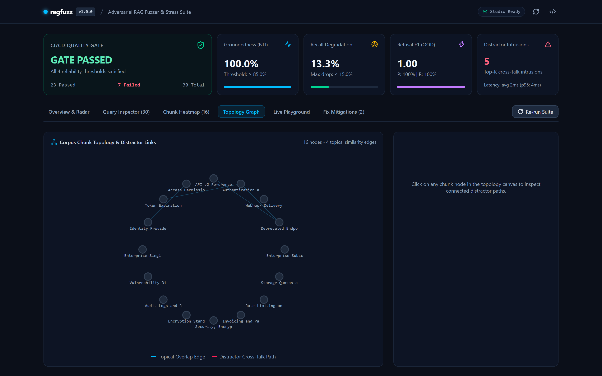
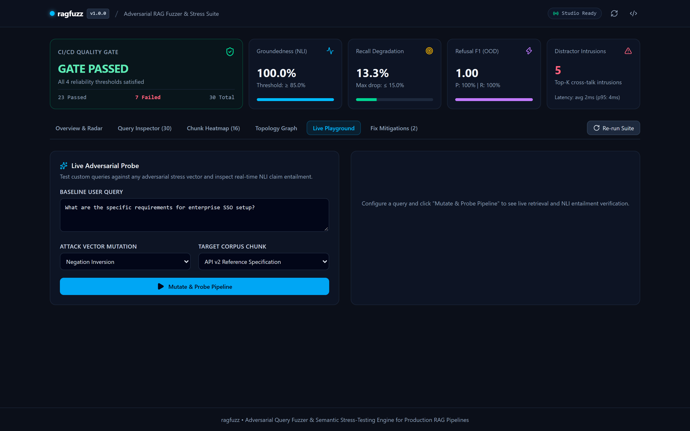
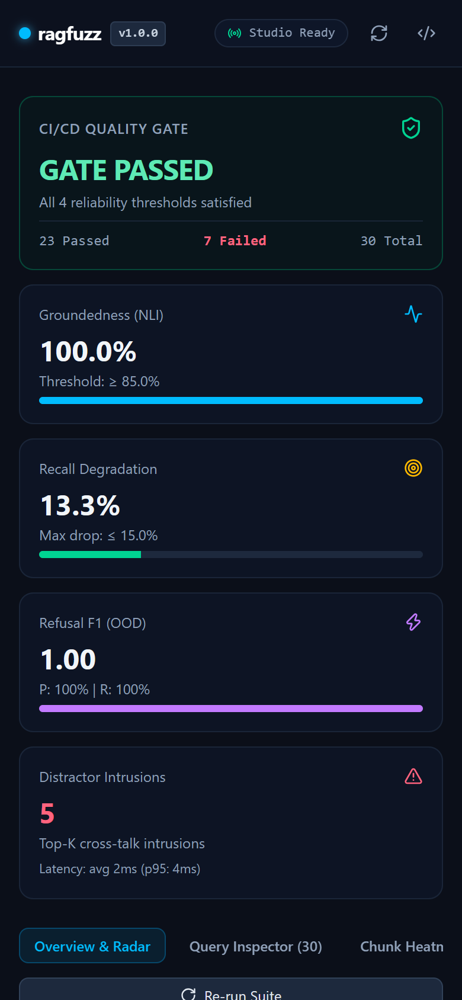

<p align="center">
  
</p>

<h1 align="center">ragfuzz</h1>

<p align="center">
  <strong>Production-Grade Adversarial Fuzzer & Semantic Stress-Testing Engine for RAG Pipelines</strong>
</p>

<p align="center">
  <a href="#quick-start"></a>
  <a href="#quick-start"></a>
  <a href="#quick-start"></a>
  <a href="LICENSE"></a>
</p>

<p align="center">
  
</p>

---

## Overview

Production RAG (Retrieval-Augmented Generation) pipelines frequently pass basic happy-path evaluations, but fail when real users introduce adversarial or noisy queries:

- **Polarity Blindness**: Dense embedding models map affirmative and negative inquiries to adjacent vector spaces, returning chunks that contradict the question (such as "Which tiers do NOT support SSO?").
- **Semantic Distractor Traps**: Chunks with high topical overlap crowd out true ground-truth context.
- **Version Collisions**: Retrievers collapse temporal distinctions between deprecated and current documentation specs (such as v1 vs v2 APIs).
- **Typographic Fragility**: Single-character typing mistakes cause steep drops in retrieval Recall@K.
- **Corpus Contradictions**: Conflicting statements across outdated documents lead LLMs to hallucinate compromises.
- **Uncalibrated Refusal**: Queries outside the knowledge base trigger confident hallucinations instead of safe refusals.

`ragfuzz` ingests your documentation corpus, synthesizes adversarial test cases across six targeted stress vectors, benchmarks your pipeline, and blocks failing builds in CI/CD. Built in Go with an embedded React 19 evaluation studio, it runs in < 20MB of RAM as a single portable binary.

---

## Evaluation Studio Interface

`ragfuzz` includes an interactive React 19 web studio compiled directly into the Go binary via `//go:embed`. It provides real-time Server-Sent Events (SSE) streaming, metric inspection, and cluster diagnostics without external runtime dependencies.

### 1. Adversarial Overview & 6-Axis Radar Scorecard
Inspect pipeline reliability across Groundedness (NLI), Recall Degradation, Refusal Calibration F1, and Distractor Intrusions.



### 2. Query Inspector & Entailment Breakdown
Review synthesized queries, inspect Levenshtein token diffs, and verify deterministic NLI claim entailment checks against retrieved chunks.



### 3. Corpus Topology & Distractor Cross-Talk
Examine pairwise BM25 and TF-IDF topic similarities across chunks to isolate high-overlap failure candidates before deployment.



### 4. Live Adversarial Playground
Run on-the-fly mutations against any corpus chunk and inspect immediate retriever ranking and generator output.



### 5. Responsive Mobile Diagnostics
Review CI/CD test run results and pipeline health on mobile and tablet devices with fully responsive layouts.

<p align="center">
  
</p>

---

## The 6 Attack Vectors

| Attack Vector | Target Vulnerability | Verification Criteria |
| :--- | :--- | :--- |
| **Negation Inversion** | Vector clustering fails on exclusion logic | Recall@K returns negative condition chunks |
| **Semantic Distractor** | Topical overlap provokes cross-chunk crosstalk | Zero distractor chunks intrude into top-K |
| **Entity / Version Swap** | Low-dimensional collapse between versions/roles | Retriever isolates exact version parameters |
| **Orthographic Noise** | Recall degrades under human typing typos | Retrieval recall resilience under Levenshtein noise |
| **Contradiction Trap** | Inconsistent documentation causes hallucinations | Pipeline reports discrepancy rather than fabricating |
| **Out-of-Domain Baits** | Ungrounded queries produce hallucinations | Refusal calibration F1 score (&ge; 0.90) |

---

## Installation

### Pre-Built Binaries
Download the latest static binary for your architecture from GitHub Releases:

```bash
# Linux (x86_64)
curl -sSL -o ragfuzz https://github.com/alexandrmotologa/ragfuzz/releases/latest/download/ragfuzz-linux-amd64
chmod +x ragfuzz

# macOS (Apple Silicon)
curl -sSL -o ragfuzz https://github.com/alexandrmotologa/ragfuzz/releases/latest/download/ragfuzz-darwin-arm64
chmod +x ragfuzz

# Windows (PowerShell)
Invoke-WebRequest -Uri "https://github.com/alexandrmotologa/ragfuzz/releases/latest/download/ragfuzz-windows-amd64.exe" -OutFile "ragfuzz.exe"
```

### Build from Source
Requirements: Go 1.24+ and Node.js 20+

```bash
git clone https://github.com/alexandrmotologa/ragfuzz.git
cd ragfuzz
make
```

This compiles the React 19 web studio and embeds all assets directly into `bin/ragfuzz`.

---

## Quick Start

### 1. Start the Local Mock RAG Server
For zero-dependency local verification, launch the built-in mock server:

```bash
go run ./examples/mock_rag_server.go -port 8080 -corpus ./examples/corpus
```

### 2. Execute an Adversarial Stress Run

```bash
ragfuzz run \
  --config examples/ragfuzz.yaml \
  --target http://localhost:8080/query \
  --queries 50
```

The CLI prints a rich scorecard, saves test artifacts (`junit.xml`, `ragfuzz-report.json`, `report.html`), and enforces non-zero exit codes on threshold violations.

### 3. Open the Interactive Evaluation Studio

```bash
ragfuzz studio --port 4040
```

Open `http://localhost:4040` in your browser to inspect the 6-axis vulnerability radar, chunk vulnerability heatmaps, and query diff viewers.

---

## CLI Command Reference

### `ragfuzz run`
Executes adversarial fuzzing against the target RAG HTTP endpoint.

Flags:
- `--config <path>`: Path to YAML configuration file (default: `ragfuzz.yaml`)
- `--target <url>`: Override target RAG endpoint URL
- `--preset <name>`: Apply integration preset (`langchain`, `llamaindex`, `openai`, `dspy`, `flowise`)
- `--corpus <path>`: Override corpus path or glob pattern (supports Markdown, JSON, and PDF)
- `--queries <n>`: Override total number of test queries to generate
- `--concurrency <n>`: Worker goroutines concurrency (default: 10)
- `--fail-below <float>`: Min groundedness threshold (0.0 to 1.0)
- `--github-summary <path>`: Export GitHub PR summary markdown
- `--studio`: Launch embedded evaluation studio after execution

### `ragfuzz studio`
Launches the embedded React 19 evaluation studio on HTTP :4040 with live SSE updates, query inspection, 2D topology cluster view, and live query playground.

Flags:
- `--port <n>`: HTTP port to bind (default: 4040)
- `--config <path>`: Path to configuration file

### `ragfuzz export`
Exports synthesized adversarial benchmarks into standard external dataset formats:

```bash
ragfuzz export --format ragas --out benchmark.json
ragfuzz export --format huggingface --out dataset.jsonl
ragfuzz export --format csv --out benchmark.csv
```

### `ragfuzz pr-comment`
Generates a formatted Markdown summary suitable for GitHub Actions step summaries or pull request comments:

```bash
ragfuzz pr-comment --report ragfuzz-report.json --out github-summary.md
```

### `ragfuzz probe`
Executes an on-the-fly single adversarial probe query against the target RAG endpoint:

```bash
ragfuzz probe --target http://localhost:8080/query --query "How does SSO setup work?" --vector negation_inversion
```

### `ragfuzz diff`
Compares two JSON evaluation reports to identify regressions between pull requests:

```bash
ragfuzz diff baseline-report.json current-report.json
```

Exits with code 1 if any vector robustness regresses by more than 5.0%.

---

## Configuration (`ragfuzz.yaml`)

```yaml
target:
  endpoint: "http://localhost:8080/query"
  method: "POST"
  headers:
    Content-Type: "application/json"
    Authorization: "Bearer ${RAG_API_KEY}"
  timeout: 10s
  concurrency: 15
  rate_limit_rps: 50
  request_template: '{"query": "{query}", "top_k": 5}'
  response_mapping:
    answer_path: "answer"
    chunks_path: "chunks"
    chunk_id_path: "id"
    chunk_text_path: "text"

corpus:
  paths:
    - "./docs"
    - "./knowledge-base/*.md"
  chunk_size: 800
  chunk_overlap: 150
  min_chunk_length: 30

fuzzer:
  total_queries: 100
  enabled_vectors:
    - "negation_inversion"
    - "semantic_distractor"
    - "entity_version_collision"
    - "orthographic_noise"
    - "contradiction_trap"
    - "out_of_domain"
  levenshtein_max_distance: 2
  seed: 42

thresholds:
  min_groundedness: 0.85
  max_recall_degradation: 0.15
  min_refusal_f1: 0.90
  max_hallucination_rate: 0.10

reporting:
  formats:
    - "terminal"
    - "junit"
    - "json"
    - "html"
  output_dir: "."
  junit_file: "junit.xml"
  json_file: "ragfuzz-report.json"
  html_file: "report.html"

studio:
  port: 4040
```

---

## CI/CD Quality Gate Setup

Integrate ragfuzz into GitHub Actions to block pull requests with hallucination regressions:

```yaml
- name: Run ragfuzz Quality Gate
  run: |
    ragfuzz run --config ragfuzz.yaml --target http://localhost:8080/query

- name: Publish JUnit Test Results
  if: always()
  uses: EnricoMi/publish-unit-test-result-action@v2
  with:
    files: junit.xml
```

---

## Documentation

- [System Architecture](docs/architecture.md)
- [Adversarial Attack Vectors](docs/attack-vectors.md)
- [CI/CD Integration Guide](docs/ci-cd-integration.md)
- [Mathematical Metrics Guide](docs/metrics-guide.md)

---

## License

MIT License. See [LICENSE](LICENSE) for details.
